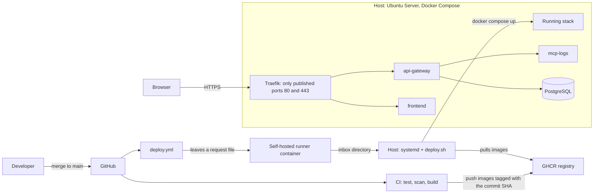
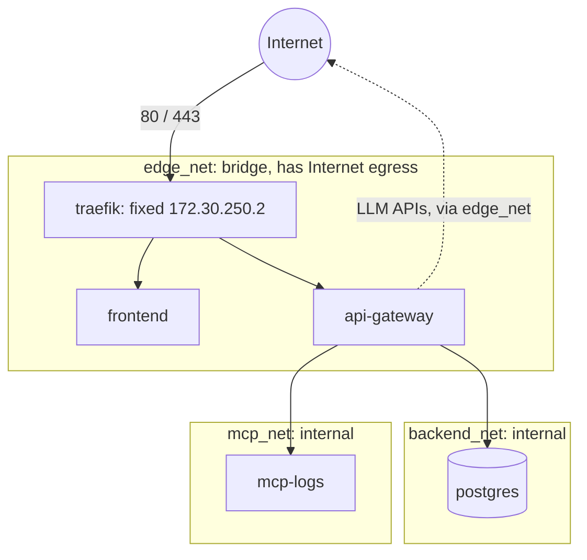
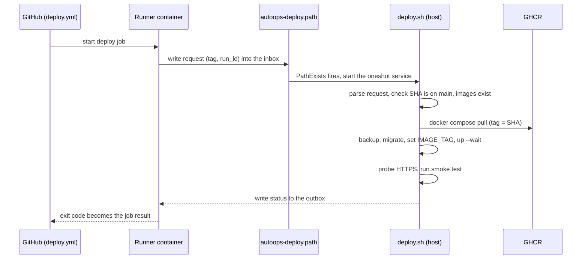

# DevOps and cloud in AutoOps, explained

A personal study guide to the DevOps and infrastructure side of AutoOps. It explains each technology, what problem it solves, why
this project uses it that way, and where it lives in the repository. Everything described here exists in the repo at the time of writing
(`main` at commit `24eec77`, PR #19). Where a claim could not be checked against the code, the git history or GitHub, it is
marked **not verified**.

Not in the repo yet, and therefore not covered: Prometheus, Grafana, Ansible, Terraform, Kubernetes and AWS (the CLAUDE.md mentions EC2 as a
possible target, but nothing in the repo deploys there; the only target today is an Ubuntu VM).

---

## 1. The big picture

AutoOps is a handful of containers on one Ubuntu Server host. A change travels from a Git merge to the running stack through a
pipeline that never gives GitHub a way into the host.



Read it in two halves:

- **Delivery** (left): code becomes immutable images in a registry, and the host *pulls* the approved version itself.
- **Runtime** (right): one reverse proxy is the only door in; everything else sits on internal networks.

The layers, from the bottom up, are the order of this document: the host (section 2), the containers (3), the networks (4), the
pipeline (5), security across all of it (6), and then real failures (7).

Repository map for everything below:

| Path | Holds |
|---|---|
| `scripts/provision/` | Idempotent host setup (`NN_*.sh`) and read-only verification (`checks/`, `verify.sh`) |
| `infra/` | Templates and docs for each host component (`ssh`, `fail2ban`, `firewall`, `docker`, `sysctl`, `systemd`, `backup`, `traefik`, `runner`, `ci`, `deploy`) |
| `docker-compose.yml`, `docker-compose.dev-db.yml` | The application stack, plus a dev-only database override |
| `apps/*/Dockerfile`, `services/mcp-servers/logs_server/Dockerfile`, `infra/traefik/Dockerfile`, `infra/runner/Dockerfile` | The images |
| `.github/workflows/` | `ci.yml`, `deploy.yml`, `runner-smoke.yml` |
| `scripts/ci/` | Guards and tests that run in CI |
| `scripts/ops/` | Scripts that run on the host: deploy, smoke test, backup, restore, env validation, user creation |

---

## 2. The Linux host and its provisioning

### 2.1 Idempotent provisioning scripts

**Concept.** A server configured by hand drifts: nobody remembers what was changed. *Provisioning* means describing the desired state in
code. A script is *idempotent* when running it twice gives the same result as running it once: it checks the current state and only
changes what differs. That makes it safe to re-run after a failure, and makes it its own documentation.

**In AutoOps.** `scripts/provision/bootstrap.sh` runs numbered steps in a fixed order and stops at the first failure:

```bash
STEPS=(10_users 20_ssh 30_fail2ban 40_ufw 50_os_baseline 60_docker 65_tls 45_docker_ufw 70_systemd 75_runner)
```

The order is by dependency, not by number: `45_docker_ufw` needs Docker, so it runs after `60_docker`. Preflight runs first and touches
nothing until it passes (Ubuntu 26.04 required, systemd active, required variables present, `docker-compose.yml` and `.env` already in
`/opt/autoops`). Every change a step makes prints a `[CAMBIO]` line, so a run with no such lines was a no-op.

Each step has a read-only twin in `scripts/provision/checks/`, and `sudo ./scripts/provision/verify.sh --env-file provision.env` runs all
of them and exits 1 on any failure. Shared helpers are in `scripts/provision/lib/common.sh`. Configuration comes from a `provision.env`
file (template: `scripts/provision/provision.env.example`).

**Why.** Rebuilding the VM from nothing must be a command, not an afternoon. The `checks/` split means "is the host still compliant?" can
be asked at any time without changing anything.

### 2.2 Users and permissions (`10_users.sh`)

- An **admin user** with `sudo`; the **root password is locked**, but only after the script confirms the admin has a usable password
  (anti-lockout).
- A **service user** `autoops` (UID/GID 1500, shell `/usr/sbin/nologin`, password locked) that owns `/opt/autoops` and runs the stack.
- The admin is **removed from the `docker` group on purpose**: membership of `docker` is root-equivalent (anyone who can start a container
  can mount `/` into it). The admin uses `sudo docker`, which asks for a password. Only the service user is in the group
  (`checks/10_users.sh` asserts it).

### 2.3 SSH (`20_ssh.sh`, `infra/ssh/`)

SSH is the way into the machine, so it is the first thing hardened. The drop-in `infra/ssh/10-autoops.conf.tpl` is installed at
`/etc/ssh/sshd_config.d/10-autoops.conf`:

```
PasswordAuthentication no
AuthenticationMethods publickey
PermitRootLogin no
AllowUsers @ALLOW_USERS@
MaxAuthTries 3
AllowTcpForwarding no
KexAlgorithms sntrup761x25519-sha512@openssh.com,curve25519-sha256,curve25519-sha256@libssh.org
```

The file is named `10-` because sshd keeps the *first* value it reads, so it must beat cloud-init's `50-cloud-init.conf`, which can re-enable
passwords.

**Anti-lockout.** Changing SSH from an SSH session can lock you out. `20_ssh.sh` arms an automatic rollback (a systemd timer and service, `autoops-ssh-rollback`) that
reverts the change after `SSH_ROLLBACK_MINUTES` unless you open a second session, prove your key works and run `20_ssh.sh --confirm`
(`infra/ssh/README.md`). `bootstrap.sh` lengthens that window to 30 minutes so it does not fire during later steps.

There is also an `autoops-deploy` account with a *forced command* (`infra/ssh/autoops-deploy-entrypoint.sh`) that only accepts the action
`deploy`. That action is a **placeholder** that prints "not implemented": the real deployment ended up using the spool design of section
5.5 instead of SSH.

### 2.4 fail2ban (`30_fail2ban.sh`, `infra/fail2ban/`)

**Concept.** Any SSH port on the internet is hit by password-guessing bots. fail2ban watches authentication failures and bans the source
address in the firewall.

**In AutoOps.** `infra/fail2ban/autoops.local.tpl` reads **journald** instead of log files (`backend = systemd`,
`journalmatch = _COMM=sshd + _COMM=sshd-session`), in line with the project's no-local-log-files rule. Defaults come from the script header:
3 failures in 10 minutes ban for 1 hour, and a *progressive* ban doubles for each repeat offence up to one week
(`bantime.increment`, `bantime.factor = 2`, `bantime.maxtime = 1w`). `FAIL2BAN_IGNOREIP` is required, so the admin's own address is never
banned. The ban action is `ufw` when UFW is present. fail2ban itself logs to syslog (`infra/fail2ban/fail2ban.local`).

### 2.5 UFW, the host firewall (`40_ufw.sh`, `infra/firewall/`)

UFW is a front end for the kernel's packet filter. The policy is deny by default:

```bash
ufw default deny incoming
ufw default allow outgoing
ufw default deny routed
ufw limit "${SSH_PORT}/tcp"        # allow, but rate-limit repeated connections
ufw allow "${port}/tcp"            # only the proxy ports (80, 443)
```

The script refuses to enable UFW unless the SSH rule is already in place and something is listening on the SSH port (anti-lockout again).
`ADMIN_CIDR` can restrict SSH to one address range.

**The Docker trap (`45_docker_ufw.sh`).** UFW does *not* protect ports published by Docker. Docker publishes `-p 8000:8000` with a NAT rule
and accepts that traffic in its own chain, which runs *before* anything UFW filters (`infra/firewall/README.md` explains the iptables path).
So a container port can be wide open even with `ufw default deny incoming`. The fix is a managed block in `/etc/ufw/after.rules` for the
`DOCKER-USER` chain, which Docker evaluates first and never flushes (`infra/firewall/docker-user.rules.tpl`):

```
-A DOCKER-USER -m conntrack --ctstate ESTABLISHED,RELATED -j RETURN
-A DOCKER-USER -i <iface> -p tcp -m conntrack --ctstate DNAT --ctorigdstport <port> --ctdir ORIGINAL -j RETURN
...
-A DOCKER-USER -j RETURN
```

Traffic arriving on an external interface toward a container is dropped unless its *original* destination port was allowed. It uses
`--ctorigdstport` because after NAT the packet carries the container's internal port, not the published one. The script validates the
syntax with `iptables-restore --test` and backs up the file before reloading. `scripts/ops/check_perimeter.sh` checks the perimeter from another machine, never from the VM itself (not run for this document: **not verified**).

### 2.6 OS baseline (`50_os_baseline.sh`, `infra/sysctl/99-autoops.conf`)

- **Automatic security patches** with `unattended-upgrades`, limited to the security channel; reboot only if `AUTO_REBOOT_TIME` is set.
- **Time sync** with `chrony`, time zone UTC. Correct time matters for TLS certificates and for log correlation.
- **Unneeded services disabled** (`avahi-daemon cups cups-browsed rpcbind bluetooth ModemManager apport`). `apport` is on the list for a concrete
  reason noted in the script: its crash handler sets `fs.suid_dumpable=2` and the baseline wants `0` (commit `223043f`).
- **Kernel parameters** (sysctl), grouped in the file: SYN-flood protection (`tcp_syncookies`), anti-spoofing (`rp_filter`), no source
  routing or ICMP redirects, `kptr_restrict`, `dmesg_restrict`, `ptrace_scope`, protected hardlinks/symlinks. One deliberate omission, stated at the top:
  `net.ipv4.ip_forward` is **not** touched because Docker needs it.

### 2.7 The Docker daemon (`60_docker.sh`, `infra/docker/daemon.json`)

Docker comes from Docker's official apt repository, with the signing key checked against a pinned fingerprint. The daemon config:

```json
{
  "no-new-privileges": true,
  "log-driver": "json-file",
  "log-opts": { "max-size": "10m", "max-file": "3" },
  "live-restore": true,
  "userland-proxy": false
}
```

- `no-new-privileges` as the default for every container.
- Log rotation (10 MB x 3), since container stdout is where logs live.
- `live-restore`: containers keep running when the daemon restarts (for example during an upgrade).
- `userland-proxy: false`: published ports use iptables rules instead of the `docker-proxy` process.

### 2.8 systemd: the stack and the jobs as units (`70_systemd.sh`, `infra/systemd/`)

**Concept.** systemd is the init system: it starts services at boot, restarts them, orders them, sandboxes them and logs them to journald.
Unit files are declarative.

**In AutoOps.** Templates (`*.tpl`) are rendered into `/etc/systemd/system/`:

| Unit | Role |
|---|---|
| `autoops.service` | `oneshot` + `RemainAfterExit`: `docker compose up -d --wait` at boot, `down` on stop (never `-v`, so volumes survive). `ExecStartPre` runs `validate_env.sh` |
| `autoops-migrate.service` | Alembic migrations, manual only (`systemctl start autoops-migrate`); never enabled at boot |
| `autoops-backup.service` / `.timer` | Scheduled PostgreSQL dump (`OnCalendar` from `BACKUP_SCHEDULE`, `Persistent=true` to catch up after downtime, `RandomizedDelaySec=15min`) |
| `autoops-deploy.path` / `.service` | The deploy channel (section 5.5) |
| `autoops-runner.service` | Keeps the self-hosted runner container up |

Key choices in `autoops.service.tpl`:

```ini
After=docker.service network-online.target ufw.service      # firewall rules loaded before ports are published
AssertPathExists=@@APP_DIR@@/.env                           # fail loudly if the deployment is incomplete
ExecStartPre=@@APP_DIR@@/scripts/ops/validate_env.sh
ExecStart=/usr/bin/docker compose up -d --wait --wait-timeout 240 --remove-orphans
NoNewPrivileges=yes
ProtectSystem=full
CapabilityBoundingSet=
RestrictAddressFamilies=AF_UNIX                             # the CLI only talks to the Docker socket
```

The sandbox keys restrict the *Compose CLI process*, not the containers (those are children of `dockerd`, a point `infra/systemd/README.md`
makes). `up --wait` blocks until every healthcheck passes, so `systemctl start autoops` only succeeds on a healthy stack.

---

## 3. Containers

### 3.1 What they are and the problem they solve

A container is a normal Linux process isolated by kernel features (namespaces for what it can see, cgroups for what it can use) and
started from an *image*: a layered, immutable filesystem snapshot. They solve "works on my machine": the image carries the exact runtime
and dependencies, so what CI tested is byte-for-byte what runs in production. AutoOps runs five services plus a one-shot `migrate`
(`docker-compose.yml`): `postgres`, `mcp-logs`, `api-gateway`, `frontend`, `traefik`.

### 3.2 Multi-stage Dockerfiles

A multi-stage build uses one stage with the heavy tools (compilers, `npm`, `pip`) and copies only the result into a small final stage.

`apps/api_gateway/Dockerfile`:

```dockerfile
FROM python:3.11-slim AS builder
RUN python -m venv /opt/venv
COPY apps/api_gateway/requirements.txt /tmp/gateway-requirements.txt
RUN pip install -r /tmp/gateway-requirements.txt -r /tmp/ai-engine-requirements.txt

FROM python:3.11-slim AS runtime
COPY --from=builder /opt/venv /opt/venv
```

The frontend does the same with Node: stage 1 `node:22-alpine` runs `npm ci && npm run build`; stage 2 `nginx:alpine` serves only the
`dist/` files (`apps/frontend/Dockerfile`). The final image has no Node, no sources and no build tools: less to patch and less to attack.
Copying the manifests (`requirements.txt`, `package*.json`) *before* the source keeps the dependency layer cached until dependencies change.

Vite embeds `VITE_*` variables at **build** time, so the Compose file passes them as build args (`/` and `/ws`, same-origin paths) rather than
reading them at runtime. They are public values, never secrets.

### 3.3 Non-root users

Processes inside a container run as root by default, and root in a container is closer to host root than people expect. All images drop it:

| Image | User |
|---|---|
| api-gateway, mcp-logs | `autoops`, UID 10001, shell `/usr/sbin/nologin`, no home (`USER autoops` / `USER 10001:10001`) |
| frontend | `nginx` (unprivileged Nginx listening on 8080; its own `nginx.conf` because the default needs root) |
| traefik | `65532:65532`, declared both in Compose (`user:`) and in the image (`USER`) |
| runner | `runner`, UID 10001 |

The Traefik `USER` line was added only because Trivy flagged its absence (check DS-0002, commit `e342ee1`): Compose already forced the
user, but an image should be safe on its own.

### 3.4 Healthchecks

A healthcheck is a command Docker runs periodically; the container is `healthy` only while it succeeds. Compose uses it for ordering
(`depends_on: condition: service_healthy`) and `up --wait` uses it to decide a deploy worked. They use tools already in the image, so no extra
package is installed:

```yaml
# postgres
test: ["CMD-SHELL", "pg_isready -U $${POSTGRES_USER} -d $${POSTGRES_DB}"]
# api-gateway (Python is already there; no curl needed)
test: [CMD, python, -c, "import os, urllib.request; urllib.request.urlopen('http://127.0.0.1:' + os.environ['PORT'] + '/health', timeout=4)"]
# frontend
test: ["CMD", "wget", "-q", "-O", "/dev/null", "http://127.0.0.1:8080/"]
# traefik
test: ["CMD", "traefik", "healthcheck", "--ping"]
```

Traefik's ping runs on an internal-only entrypoint `:8082` that is never published. The resulting start order is
`postgres` / `mcp-logs` -> `api-gateway` -> `frontend` -> `traefik`: **Traefik starts last.** That fact matters in case study 7.3.

### 3.5 Hardening in Compose

A YAML anchor applies the same two settings to nearly every service:

```yaml
x-hardening: &hardening
  cap_drop: [ALL]
  security_opt: ["no-new-privileges:true"]
```

- `cap_drop: [ALL]`: Linux splits root's power into ~40 *capabilities*. The services need none of them, so all are dropped.
- `no-new-privileges`: a process can never gain more privileges than it started with (blocks setuid tricks).
- `read_only: true`: the container's root filesystem is immutable; an attacker who gets code execution cannot drop a binary or edit files.
  Services that need scratch space get `tmpfs: [/tmp]` (RAM-backed, wiped on restart).

Exceptions are explicit and justified in comments:

- `postgres` starts as root and drops to the `postgres` user, so it gets back exactly `CHOWN, DAC_OVERRIDE, FOWNER, SETGID, SETUID`. It is also
  not `read_only` because it writes its data volume.
- `traefik` adds only `NET_BIND_SERVICE` (binding ports 80/443 as a non-root user, so it never depends on a sysctl default).
- Only Traefik publishes host ports. Traefik's config is baked into its image, and **the Docker socket is never mounted** anywhere (it would
  hand out root).

### 3.6 Docker Compose

Compose describes a multi-container app in one file. Features used here:

- **Required variables fail loudly:** `${DB_USER:?set DB_USER in .env}`, `${JWT_SECRET:?set JWT_SECRET in .env (openssl rand -hex 32)}`.
  A missing setting stops `docker compose config`, so CI catches a renamed variable. (Section 7.1 shows the flip side: a *stale* Compose file can demand
  a variable you removed.)
- **Image names by registry and tag:** `image: ${IMAGE_REPOSITORY:-autoops}/api-gateway:${IMAGE_TAG:-dev}`. Locally it builds `autoops/api-gateway:dev`;
  on the host `IMAGE_REPOSITORY=ghcr.io/<owner>/autoops` and `IMAGE_TAG=<commit SHA>` make it run exactly a published commit.
- **Profiles:** `migrate` has `profiles: [tools]`, so `up` never runs it implicitly; it is an explicit step (`docker compose --profile tools run --rm migrate`).
- **Override file:** `docker-compose.dev-db.yml` is a development-only addition, validated in CI together with the base file.
- **Named volumes:** `postgres_data` (the database) and `acme` (Let's Encrypt state). `down` without `-v` keeps them.
- **Everything is configured by environment variables**, in line with the twelve-factor rule in `.claude/CLAUDE.md`.

---

## 4. Networks

### 4.1 The model

A Docker *bridge network* is a private virtual switch with its own address range. Services on a network resolve each other by service name
(`postgres`, `mcp-logs`). A network marked `internal: true` has no route out: no Internet, and no host access.



| Network | Members | Property |
|---|---|---|
| `edge_net` | traefik, frontend, api-gateway | Has Internet egress: Traefik for ACME, the gateway for LLM APIs |
| `backend_net` | api-gateway, postgres | `internal: true` |
| `mcp_net` | api-gateway, mcp-logs | `internal: true` |

This is how the project's rule "the AI engine never connects to PostgreSQL directly" is enforced by the network and not only by convention: the
database sits on a network where only the gateway is present, and MCP servers sit on a separate one. The gateway is the only service on all three,
and it is the controlled bridge between them. The runner has its own `runner_net` (`infra/runner/docker-compose.yml`) that shares nothing with these.

### 4.2 Traefik as the only entrance

A *reverse proxy* is the single public front door: it terminates TLS and forwards each request to the right internal service. The alternative,
publishing each container's port, multiplies the attack surface and the certificates.

`infra/traefik/dynamic/routes.yml` routes one domain by path, and rejects any other `Host` with a 404:

```yaml
gateway:
  rule: 'Host(`{{ env "DOMAIN" }}`) && (PathPrefix(`/api`) || PathPrefix(`/ws`))'
  priority: 20
frontend:
  rule: 'Host(`{{ env "DOMAIN" }}`)'
  priority: 10
```

The frontend and the API therefore share **one origin**, which is why CORS needs a single allowed origin and the browser never makes cross-origin calls.
WebSocket upgrades need no extra config. Design choices in `infra/traefik/traefik.yml`:

- The **file provider** with `watch: true`; the Docker provider is absent *on purpose* because it would require mounting the Docker socket.
- The Traefik API and dashboard are disabled.
- JSON logs to stdout/stderr (access log included): no log files.
- The configuration is **baked into the image** (`infra/traefik/Dockerfile`), so it is immutable and independent of host file permissions.
  `entrypoint.sh` only appends the ACME resolver to a copy under `/tmp` when `TLS_MODE=acme`, because Traefik's static config cannot read environment variables.

### 4.3 HTTPS and the local CA

`TLS_MODE` has no default and chooses where the certificate comes from:

- `selfsigned`: `scripts/provision/65_tls.sh` creates a **local root CA** (10 years) and a leaf certificate (365 days; browsers reject longer) for `DOMAIN`.
  The leaf is reissued automatically when missing, signed by a different CA, within 30 days of expiry or when its names differ. The **CA private key stays
  root-only and is never mounted into a container**; only `tls/server/` (leaf cert and key) is mounted read-only. You import `ca.crt` into your
  browser or OS once (`infra/traefik/README.md`).
- `acme`: Let's Encrypt using the HTTP-01 challenge, for a public domain.

Why a local CA rather than a plain self-signed certificate: trust it once and every certificate it signs works, and clients (`curl --cacert`,
`scripts/ops/e2e_https.py --ca`, the smoke test) can verify the chain properly instead of switching verification off.

### 4.4 HSTS and the HTTP redirect

Port 80 only redirects to HTTPS (`permanent: true` in `traefik.yml`, which also keeps the ACME HTTP-01 challenge reachable). A middleware adds
`Strict-Transport-Security` with `stsSeconds` from `HSTS_MAX_AGE_SECONDS` (default 31536000, one year, deliberately without `includeSubDomains` or
`preload`). HSTS tells a browser to refuse plain HTTP for that domain for that long, defeating downgrade attacks. The infra README warns that this
sticks in browsers, so lower the value if that is unwanted. The smoke test checks both the header and the redirect.

### 4.5 Traefik's fixed IP and `ip_range`

The gateway runs uvicorn with `--proxy-headers`, which makes it believe `X-Forwarded-For` as the client address. If any peer could set that header, the login rate limit
(per client IP) would be trivial to evade. So `FORWARDED_ALLOW_IPS` is set to Traefik's address, and for that to work Traefik needs a **known, fixed
address**:

```yaml
traefik:
  networks:
    edge_net:
      ipv4_address: ${EDGE_TRAEFIK_IP:-172.30.250.2}

networks:
  edge_net:
    ipam:
      config:
        - subnet: ${EDGE_SUBNET:-172.30.250.0/24}
          ip_range: ${EDGE_IP_RANGE:-172.30.250.128/25}
```

`ip_range` is the pool Docker draws *dynamic* addresses from (`.128`-`.255`). Traefik's static `.2` lies outside it, so no other container can ever be
handed that address. Without `ip_range`, the dynamic pool is the whole subnet, and that is the bug in section 7.3. `scripts/ci/check_edge_net.sh` keeps
the invariant (section 5.2).

---

## 5. CI/CD

### 5.1 Concepts

*Continuous integration* means every change is automatically built and tested before it is merged. *Continuous delivery* means a change that passes
is automatically released. The risk to design around is trust: whoever can run code in the pipeline can reach whatever the pipeline can reach.
AutoOps splits the pipeline into a part that is untrusted-but-powerless and a part that is powerful-but-never-runs-workflow-code.

### 5.2 The jobs of `ci.yml`

Runs on pull requests and pushes to `develop` and `main`, GitHub-hosted (`ubuntu-24.04`), default `permissions: contents: read`, and no
`pull_request_target`. Concurrency cancels a superseded PR run but never a run on `main`.

| Job | What it does |
|---|---|
| `backend` | `pytest tests/ -v` on Python 3.11 with `PYTHONPATH=.github/ci/nonet`; that `sitecustomize.py` makes any non-loopback socket connection raise, so a test that quietly needs the network or an LLM fails instead of passing |
| `frontend` | `npm ci`, lint (oxlint), typecheck, `npm test`, build; Node version from `.nvmrc` |
| `compose` (matrix) | `docker compose config -q` for `selfsigned`/`acme` x with/without dev-db, plus a pinned-image cell; runs `scripts/ci/check_edge_net.sh` |
| `compose-guard` | Removes `TLS_MODE` and requires Compose to be *rejected* with a message naming it |
| `shellcheck` | Lints every tracked `*.sh` at severity `warning` |
| `images` | Builds the four images with `docker buildx bake --load`, checks the Dockerfile Node version equals `.nvmrc`, scans each image with Trivy, builds the runner image |
| `runner-compose` | `check_runner_compose.sh`: the runner Compose, *resolved*, still has no Docker socket, no ports, no privileges, only two bind mounts |
| `runner-workflows` | `check_runner_workflows.sh`: a workflow that targets the self-hosted runner may only be triggered by `workflow_dispatch` or `push` to `main`, and must declare `environment: production` |
| `deploy-guards` | The test scripts for deploy, smoke test, request handoff, `validate_env.sh`, `create_user.sh` and the edge_net guard |
| `lint-python` | `ruff check .` |
| `dependency-audit` | `pip-audit` and `npm audit` |
| `trivy-config` | Trivy misconfiguration scan of the Dockerfiles |
| `ci` | The aggregate gate: requires every job above to be `success` |
| `publish` | `main` only, after `ci`: pushes the images |

Patterns worth learning from this file:

- **One required status.** Branch protection requires only `ci`, which `needs` all the others and runs with `if: always()`. Adding a job means adding it to `needs`;
  it never touches the protection rule.
- **Guards that must bite.** `check_edge_net.sh`, `check_runner_compose.sh` and `check_runner_workflows.sh` are paired with `test_*_guard.sh`
  scripts that feed a deliberately weakened input and require the guard to fail, one mutation per rule. A guard that never fails proves nothing.
- **Checks on the resolved model, not on text.** The runner guard reads `docker compose config` output and parsed YAML, so comments and YAML anchors cannot fool it.
- **Fake `docker` and `curl`.** `test_deploy.sh` and `test_smoke.sh` replace those binaries with stubs, so the whole deploy flow (success, failed pull,
  failed health gate, rollback) is tested without a Docker daemon.

### 5.3 GHCR and SHA tags

The `publish` job is the only one with `packages: write` and authenticates with the built-in `GITHUB_TOKEN`; there is no other secret in the workflow
(`grep secrets\. .github/workflows/*.yml` finds that single use). It builds and pushes four images:

```bash
export IMAGE_REPOSITORY="ghcr.io/${OWNER,,}/autoops"     # GHCR needs lowercase
docker buildx bake -f docker-compose.yml --push \
  --set "*.labels.org.opencontainers.image.revision=${IMAGE_TAG}" \
  api-gateway frontend mcp-logs traefik
```

Tags are the **full commit SHA**: immutable, and traceable to the exact code. There is no `latest`, because a moving tag makes "what is running?" unanswerable and
makes a rollback ambiguous. `validate_env.sh` rejects `IMAGE_TAG` empty or `dev` in production. OCI labels (`source`, `revision`, `created`) are written into the images; the `source` label
also links the package to the repository, which is what lets `GITHUB_TOKEN` keep pushing.

### 5.4 The self-hosted runner

**Why one exists.** `deploy.yml` has to hand work to the host, which is not reachable from GitHub. A *self-hosted runner* is an agent on your machine that
GitHub dispatches jobs to. The danger: it executes whatever the workflow says. The repo is public, so the runner is treated as **untrusted code
running next to the host**.

`infra/runner/` is a Compose project of its own (so `autoops.service`'s `up --remove-orphans` and `down` never touch it, and a runner failure never touches the stack).
Its Compose file removes everything it can:

```yaml
cap_drop: [ALL]
security_opt: ["no-new-privileges:true"]
read_only: true
pids_limit: ${RUNNER_PIDS_LIMIT:-512}
mem_limit: ${RUNNER_MEMORY_LIMIT:-2g}
tmpfs:
  - /home/runner/runner/_work:uid=10001,gid=10001,mode=0700,size=...
```

- No Docker socket, no Docker client, no `sudo`, no published ports; a single network.
- The workspace is a `tmpfs`, so each job starts empty and nothing survives a restart. (That tmpfs is mounted `noexec`, which is why `deploy.yml` runs
  `bash scripts/ci/request_deploy.sh` instead of executing the file: PR #10.)
- Its image downloads the official runner release and **verifies a SHA-256** (`sha256sum --check --strict`); self-update is disabled because the root filesystem is read-only.
- The registration token is a Docker secret read from a file, needed only on first start.
- `runner-smoke.yml` (manual) proves from *inside* the container that it can reach GitHub and nothing else.

### 5.5 `deploy.yml` and the pull-based handoff

`deploy.yml` triggers on `push` to `main` and `workflow_dispatch` only, with `permissions: {}`, and `concurrency: deploy` with `cancel-in-progress: false`
(a deploy already in flight is never abandoned). Two jobs:

1. `wait-for-ci` (GitHub-hosted): polls the `CI` run for the same commit every 20 s, up to ~28 min, and requires the `ci` **and** `publish` jobs to be `success`. A red,
   cancelled or missing CI ends here and the host is never asked. (`workflow_run` is not an allowed trigger for runner workflows, hence the polling.)
2. `deploy` (the self-hosted runner, `environment: production`, limited to `main` in GitHub settings): runs `scripts/ci/request_deploy.sh`.

The point of the design is that GitHub **never holds a way into the host**. The runner can only *leave a note*:

```
workflow job (runner container)                host (systemd, user autoops)
scripts/ci/request_deploy.sh                   autoops-deploy.path  (PathExists=<inbox>/request)
  writes tag=<sha> / run_id=<n> -> inbox (rw)    -> autoops-deploy.service (Type=oneshot)
  polls status  <- outbox (read-only)               -> scripts/ops/deploy.sh --request-file ...
```



### 5.6 How the host validates and applies (`scripts/ops/deploy.sh`)

The request is **untrusted input**. The parser accepts a regular file of at most 256 bytes with exactly two keys, `tag` (`^[0-9a-f]{40}$`) and `run_id`
(`^[0-9]{1,20}$`); symlinks, unknown or duplicate keys, CR/NUL bytes are rejected (`reason=invalid_request`), and values are never passed to a shell.
Then, in order (the header comment of `deploy.sh` and `infra/deploy/README.md` give the same list):

1. **Provenance:** the public GitHub compare API must say the SHA is `ahead` of or `identical` to `main`, and ahead of the running release (no downgrade through the runner).
   The host holds no GitHub token and fails closed (`provenance_unavailable`).
2. **Registry check:** `docker manifest inspect` for all four images (`images_missing` if not).
3. `docker compose pull` with `IMAGE_TAG` set only in that command's environment.
4. Start `postgres`, take a backup, run the Alembic migration.
5. **Point of no return:** rewrite `IMAGE_TAG` in `.env` (atomically, keeping mode `0600`), `docker compose up -d --wait`.
6. **Health gate:** probe `https://$DOMAIN/api/v1/health` up to 12 times, then run `smoke_test.sh`.
7. Success records `current` and `previous` tags. Any failure after step 5 puts the previous tag back, runs `up` again and **probes the rollback too**.

The final status is a fixed vocabulary, never raw command output (so it can safely be shown in a job summary):

```
state=<running|succeeded|rolled_back|failed>
reason=<none|invalid_request|preflight|provenance_unavailable|provenance_rejected|images_missing|pull_failed|backup_failed|migrate_failed|apply_failed|health_failed|smoke_failed|unexpected_error>
rollback=<none|ok|failed>
```

Exit codes returned to the job: 0 succeeded, 1 rolled back, 2 failed, 3 no answer. A `flock` plus the `oneshot` unit guarantee a single deploy at a time.

**The smoke test** (`scripts/ops/smoke_test.sh`) runs on the host, over HTTPS through Traefik, read-only. It checks: the frontend answers 200 with HTML; the API health
path answers 200; a protected path (`/api/v1/tickets`) answers **401** without a token; HSTS is set; HTTP redirects to HTTPS; and the `api-gateway` container runs the deployed tag.
It lives on the host because the runner cannot reach the stack by design.

**Limits to remember** (from `infra/deploy/README.md`): a rollback restores **images only**, never the schema, so migrations must be backward compatible
(expand, then contract); and a pre-migration dump exists for the destructive case.

---

## 6. Security in layers

No single control is trusted; each layer assumes the one before it failed.

| Layer | Controls | Where |
|---|---|---|
| Perimeter | UFW deny-by-default, `DOCKER-USER` rules, only 80/443 (plus SSH) open | `infra/firewall/`, `40_ufw.sh`, `45_docker_ufw.sh` |
| Access | Key-only SSH, no root login, fail2ban, locked root password, admin outside `docker` group | `infra/ssh/`, `infra/fail2ban/`, `10_users.sh` |
| Network | Internal networks, one published entrypoint, TLS + HSTS | `docker-compose.yml`, `infra/traefik/` |
| Container | non-root, `cap_drop: [ALL]`, `no-new-privileges`, `read_only`, no Docker socket | Dockerfiles, `docker-compose.yml` |
| Application | JWT auth, argon2 hashing, login rate limit | `apps/api_gateway/` |
| Pipeline | SHA-pinned actions, least-privilege tokens, runner lock-down, provenance check | `.github/workflows/`, `scripts/ci/`, `deploy.sh` |
| Recovery | Pre-deploy backups, scheduled backups | `scripts/ops/backup_postgres.sh`, `infra/backup/` |

### 6.1 Secrets and `.env`

Zero hardcoding: every credential, URL and port comes from environment variables. `.env.example` is the committed template with placeholders; the real `.env` is
git-ignored and mode `0600` on the host (`deploy.sh` preserves `0600` when it rewrites `IMAGE_TAG`). `.env` is **read, never sourced**: the helper `env_value` extracts
one key with `grep`, so a value containing spaces, `*` or `$(...)` cannot execute. Different environments are different `.env` files with the same keys; the environment is chosen by
`ENVIRONMENT`, `TLS_MODE`, `IMAGE_TAG`. CI never sees a production configuration: it builds from `.env.example`, whose placeholders `validate_env.sh` rejects by design.

### 6.2 `validate_env.sh`

Wired as `ExecStartPre=` in `autoops.service`. **Only when `ENVIRONMENT=production`** it refuses to start if `DB_PASSWORD` is empty or a known placeholder, if `JWT_SECRET` is empty,
a placeholder or shorter than 32 characters (the gateway enforces the same at startup), or if `IMAGE_TAG` is empty or `dev`. A leftover legacy `SECRET_KEY` is
only rejected if it is a placeholder. Any other `ENVIRONMENT` prints "production checks skipped" and exits 0 (see 7.6).

### 6.3 Authentication, rate limit and the proxy

Added by PR #17. `POST /api/v1/auth/login` returns a JWT (`JWT_TTL_MINUTES`, default 60); passwords are hashed with **argon2id** (`argon2-cffi`, `PyJWT` in
`apps/api_gateway/requirements.txt`). Every REST endpoint except login and health requires the token. For the WebSocket the token is the **first message**, not the URL,
because Traefik logs URLs; missing or expired tokens close the socket with code `4401`. Unknown user, wrong password and disabled user return an identical `401`,
and an unknown user costs the same hashing work, to avoid user enumeration by timing.

The failed-login limiter (`apps/api_gateway/rate_limit.py`) is a sliding window per client IP, default 5 failures per 300 s, answering `429` with `Retry-After`. It is in memory, valid for the
single-container deployment; the module docstring says several replicas would need a shared store. It depends on the proxy-header trust of section 4.5. There is no refresh token and a
single role (PR #17 caveats). Users are created with `scripts/ops/create_user.sh`, which prompts inside the gateway container so nothing lands in `.env`, shell history or arguments.

### 6.4 Scans

| Scan | Scope | Fails the CI on |
|---|---|---|
| `ruff` (`ruff==0.17.4`) | All Python; rules in `ruff.toml`, including `S` (bandit) | Any finding |
| `pip-audit` (`2.10.1`) | The three `requirements.txt` | Any advisory (it has no severity filter) |
| `npm audit --omit=dev` | `apps/frontend` | `high` and above |
| Trivy image | The four built images | HIGH/CRITICAL **with a fix available** (`ignore-unfixed: true`) |
| Trivy config | Every Dockerfile | HIGH/CRITICAL misconfiguration |
| ShellCheck | Every `*.sh` | `warning` and above |

Trivy cannot parse Compose files, so Compose is covered by the `compose` jobs and `scripts/ci/check_*.sh` instead; the upstream `postgres` image is not scanned. A suppression goes in
`.trivyignore`, which is currently empty and requires a justification (reason, who, date, review date) for every entry (`infra/ci/README.md`). Because the vulnerability database
is fetched at run time, a new CVE can turn a previously green commit red; that is intended.

### 6.5 Actions pinned by SHA

Every third-party action is pinned to a full commit SHA with the version in a trailing comment:

```yaml
- uses: actions/checkout@3d3c42e5aac5ba805825da76410c181273ba90b1 # v7.0.1
  with:
    persist-credentials: false
```

A tag like `v4` is a *movable pointer*: whoever controls the repo (or steals its credentials) can repoint it to different code. A commit SHA cannot be repointed. Section 7.4
shows both why this matters and the way it can still go wrong. Also in the workflows: `persist-credentials: false` on every checkout, and `permissions: {}` or `contents: read` as the base.

### 6.6 Backups

`scripts/ops/backup_postgres.sh` runs `pg_dump` (custom format) *inside the postgres container* using its own injected variables, so database credentials never touch the host. Dumps are
`autoops_db_<timestamp>.dump`, mode `0600`, in `BACKUP_DIR` (`0700`, outside the data volume), rotated after `BACKUP_RETENTION_DAYS` (default 7). `autoops-backup.timer` schedules it; `deploy.sh`
also takes one before every migration. Restore is `scripts/ops/restore_postgres.sh` (destructive, asks for confirmation; procedure in `infra/backup/README.md`). The README is explicit about what is
**out of scope**: remote copies, dump encryption and point-in-time recovery. A dump on the same disk does not survive losing the disk.

---

## 7. Case studies: real failures

These come from the first deploy of the authentication release (PR #17) and the security-scan work (PR #19). For each one, what the repository can prove is separated
from what comes from the maintainer's account of what happened on the host. The host's journal and `/opt/autoops` contents are not in the repo, so those details are marked.

### 7.1 First deploy with authentication: `reason=pull_failed` although the download was fine

**Symptom.** The deploy ended `state=failed reason=pull_failed`, but the images existed and were downloadable.

**Root cause.** The `docker-compose.yml` in `/opt/autoops` was **stale**: a Git clone on the host that nobody had updated. That older file still demanded `SECRET_KEY`,
which had already been removed from the host's `.env`.

What the repo proves:

- Before PR #17 the Compose had `SECRET_KEY: ${SECRET_KEY:?set SECRET_KEY in .env}` and no `JWT_SECRET` (`git show ab93011^:docker-compose.yml`). After it, the reverse.
- `deploy.sh` runs `docker compose pull` from `APP_DIR`, using *whatever Compose file is on the host*: `compose_tag() { (cd "$APP_DIR" && IMAGE_TAG="$tag" docker compose "$@"); }`.
  Compose interpolates the whole file before pulling, so a missing required variable makes the command exit non-zero, and any non-zero `step_pull` is labelled `pull_failed`:
  `step_pull "$TAG" || { finish failed pull_failed none || true; return 1; }`.
- Nothing in `scripts/` or the workflows updates the host's clone (no `git pull` or `git clone` anywhere outside docs). `deploy.sh` only changes `IMAGE_TAG` in `.env`.

**Diagnosis.** The error label said "pull", so the first suspicion was registry access. The way out is to read the real error in the journal
(`journalctl -u autoops-deploy.service`), where the Compose interpolation message names the missing variable. *The actual journal output is **not verified** (not in the repo).*

**Fix.** Update the checkout in `/opt/autoops` to the commit being deployed (the exact commands used on the host are **not verified**).

**Lesson.** CD changes **images and `IMAGE_TAG`, not the host's files**. `docker-compose.yml`, `scripts/` and the systemd units on the host are a separate artifact with their own lifecycle, and the
host must be updated deliberately. A reason code names the *step* that failed, not the *cause*: `pull_failed` meant "the `compose pull` command failed", and a configuration error inside that command looks the same
as a network error. The rollout notes in `infra/deploy/README.md` ("Keep `SECRET_KEY`...") exist because of this coupling between the Compose file and `.env`.

### 7.2 Second attempt: `apply_failed`, gateway "unhealthy", `rollback=ok`

**Symptom.** After the clone problem was addressed, the next attempt ended `apply_failed` with the gateway container `unhealthy`; the rollback succeeded.

**Probable cause (not confirmed).** The gateway **refuses to start without `JWT_SECRET`** (PR #17: no default, at least 32 characters). The pre-auth Compose file does not pass `JWT_SECRET` into the
container at all (verified from `git show ab93011^:docker-compose.yml`, which has only `SECRET_KEY`). If the Compose file in use was still the old one, the new image would start without the variable, exit at startup and never become healthy,
so `up --wait` fails, which is `apply_failed`. This fits the facts but I could not confirm it: the host's Compose version at that moment and the gateway's log are not in the repo.

**Why `rollback=ok` here.** The failure was before the health probe, in `step_apply`, and the rollback restored the previous tag and passed its own probe. Contrast with 7.3.

**Lesson.** A health gate is only as informative as the evidence you keep: the first thing to read is `docker compose logs api-gateway`, which for a startup refusal says exactly what is missing. And this is the same root issue as 7.1: the Compose file on the
host and the image must be a matching pair.

### 7.3 Third attempt: `apply_failed`, `rollback=failed`, site down (PR #18)

**Symptom.** `apply_failed` again, but this time `rollback=failed`: the site was **down**. Traefik was stuck in `Created` (never started).

**Root cause.** Address collision on `edge_net`. PR #17 gave `edge_net` a fixed subnet and Traefik a fixed `ipv4_address` (`172.30.250.2`) so the gateway could trust `X-Forwarded-For` from exactly that peer (section 4.5).
But Docker hands *dynamic* addresses out of the **entire subnet** unless told otherwise, so another container took `.2`. PR #18's description records the error: Traefik did not start with `Address already in use`.

Why it was deterministic rather than random (my reasoning from the Compose file and Docker's lowest-free-address allocation; the exact allocation order on the host is **not verified**): Traefik has `depends_on` both the gateway and the frontend being healthy, so it
**starts last**. The first dynamic container to join the network after the gateway address (`.1`) would get `.2`, so by the time Traefik starts, its address is taken. The pre-auth Compose had no fixed address at all, which is why the problem first appeared with this release.

**Why the rollback failed too (inference, not confirmed).** The rollback runs `up` against the same Compose file and the same network, so the same collision applies; and the old release also cannot satisfy the new probe, a known caveat written into PR #17 (the pre-auth release has no `/api/v1/health` and answers 200 to `/tickets`). Both mean "rolling back to a release without auth" is unreliable on that first deploy.

**Diagnosis.** `docker compose ps` shows Traefik `Created`, and `docker compose logs`/`docker inspect` give the `Address already in use` error (the diagnostic commands the maintainer ran are **not verified**; the error text is verified from PR #18).

**Recovery (maintainer's account, not verified in the repo).** Starting Traefik **before** the other services let it claim `.2` first, and the site came back.

**Fix (PR #18, commit `7866e3f`).** `ip_range: ${EDGE_IP_RANGE:-172.30.250.128/25}` so dynamic addresses come only from `.128`-`.255`, and a CI guard, `scripts/ci/check_edge_net.sh`, run in the `compose` job on the *resolved* model. It fails if: `ip_range` is
missing, outside the subnet or covers all of it; a fixed address is outside the subnet, is the network/broadcast/gateway address, falls inside `ip_range` or is shared; Traefik has no fixed address; or `FORWARDED_ALLOW_IPS` is not Traefik's address.
`scripts/ci/test_edge_net_guard.sh` has one mutation per rule, **including the original bug** (Traefik's IP inside the range). Docker cannot change the IPAM of an existing network, so the host had to `docker compose down` (without `-v`, so `postgres_data`
survives) once so `up` could recreate `edge_net` (procedure in `infra/deploy/README.md`).

**Lessons.**
- If an address matters, **reserve it**: fixed addresses and dynamic pools must be disjoint by construction.
- A bug found in production should become a **CI guard** that fails on the exact original mistake.
- A rollback is only as good as its preconditions; one that shares the broken ingredient (same Compose, same network) does not restore anything.
- PR #18 itself notes what was **not** tested before merge: a real Docker daemon (the dev machine had no access), so the recreate step ran for the first time on the host.

### 7.4 Supply chain: the Trivy and `trivy-action` compromise, and a SHA that did not resolve

**Background.** In March 2026 the Trivy scanner's GitHub Actions were compromised: according to Aqua's own account and several security vendors, on 19 March 2026 an attacker with stolen credentials force-pushed most of the version
tags of `aquasecurity/trivy-action` (and `setup-trivy`) to malicious commits that stole CI secrets, and also published a malicious Trivy release (0.69.4). The tags were live for roughly half a day (the exact number of tags differs between sources: 75 of 76 or 76 of 77). Tracked as CVE-2026-33634.
The crucial detail for a pipeline author: **anyone using `@v0.35.0`-style tags got the malicious code**, while anyone pinned to a *commit SHA* did not. Sources:
[Aqua](https://www.aquasec.com/blog/trivy-supply-chain-attack/), [Socket](https://socket.dev/blog/trivy-under-attack-again-github-actions-compromise),
[Wiz](https://www.wiz.io/ja-jp/blog/trivy-compromised-teampcp-supply-chain-attack), [Snyk](https://snyk.io/articles/trivy-github-actions-supply-chain-compromise/).

**What happened in this repo.** PR #19 (`fe60319`) added Trivy to `ci.yml`, pinned by SHA like every other action. Commit `2defc2b` later replaced the pin:

```
-  uses: aquasecurity/trivy-action@a9c7b0f06e461e9d4b4d1711f154ee024b8d7ab8 # v0.36.0
+  uses: aquasecurity/trivy-action@ed142fd0673e97e23eac54620cfb913e5ce36c25 # v0.36.0
   "The previous SHA does not exist in aquasecurity/trivy-action."
```

**What I could verify against GitHub** (with `gh api` and `git ls-remote`, on 2026-11-11):

- `ed142fd...` is a real **commit** in `aquasecurity/trivy-action`, dated 2026-04-22 ("chore: update action version to v0.36.0 in examples"), i.e. after the March incident, and the tag `v0.36.0` points at it.
- The old `a9c7b0f...` is **not a commit** (`commits/a9c7b0f...` answers `422 No commit found`). It *does* exist as a git object: it is the **annotated tag object** of `v0.36.0`. `git ls-remote` prints two lines for such a tag:

```
a9c7b0f06e461e9d4b4d1711f154ee024b8d7ab8   refs/tags/v0.36.0        <- the tag object, NOT a commit
ed142fd0673e97e23eac54620cfb913e5ce36c25   refs/tags/v0.36.0^{}     <- the commit the tag points to (use this one)
```

So the maintainer's description that the old SHA "was written from memory" does not match what the evidence shows: the old value is exactly the unpeeled tag-object SHA, which `uses:` cannot resolve as a commit. I cannot tell how it was obtained (memory, copy from the wrong
`ls-remote` line, or a tool), so **how the wrong value got there is not verified**. What is verified: it was not a commit and was replaced by the commit the official tag points to. Note also that the repo's own `infra/ci/README.md` already says to take the `^{}` line for annotated tags (written in `37b27e2`, 2026-10-28),
which is the rule that would have prevented this.

**What was checked about exposure.** I confirmed in `ci.yml` that the jobs that run Trivy (`images`, `trivy-config`) declare no secrets: the workflow's only secret reference is `secrets.GITHUB_TOKEN` in the `publish` job, the base permission is `contents: read`, checkouts use `persist-credentials: false`, and
Trivy runs on GitHub-hosted runners, never on the self-hosted one. The statement that this check was done at the time of the fix comes from the maintainer; I re-derived it from the file as it is now. Whether any Trivy run on 19-20 March touched this repo is irrelevant here (the repo's Trivy was added in November 2026); that part is **not verified**.

Commit `e61c560` also pins the **Trivy binary** to `v0.70.0` (the action's default, verified by CI): "Bumped on purpose in a reviewed change, never automatically".

**Lessons.**
- Pinning by SHA only helps if the SHA is **verified** to be the commit you mean. A SHA that does not resolve fails loudly, which is the good outcome; a *plausible but wrong* SHA that does resolve would not.
- For annotated tags, take the peeled `^{}` commit, never the tag object.
- Pin the thing an action downloads too (the Trivy version), not only the action.
- Least privilege is the second line of defense: even a compromised action in a job with no secrets and a read-only token has little to steal.

### 7.5 Trivy findings and how each was resolved

PR #19 added the scans; the first real runs found problems. All fixed in November 7, 2026 commits (CVE IDs below are quoted from the commit messages, which I did not re-check against a vulnerability database):

| Finding | Where | Resolution |
|---|---|---|
| `zlib1g` (CVE-2026-76844, CVE-2026-85091) | Debian layer of the `python:3.11-slim` base, in gateway and mcp-logs | `0793a0a`: in the runtime stage, `apt-get install -y --no-install-recommends --only-upgrade zlib1g` and clean the apt lists. Temporary by design: the Dockerfile comment says to remove the step when the base ships `1:1.3.dfsg+really1.3.1-1+deb13u1` or later |
| Vendored `jaraco.context` and `wheel` inside `setuptools` (CVE-2026-23949, CVE-2026-24049) | Packaging tools in the venv, then **also** in the base image's own system Python | `3dbae9e`: `pip uninstall -y pip setuptools wheel` in the **builder** so the venv copied into runtime lacks them. That was not enough: `9f47b66` found the base's own `setuptools 79.0.1` vendors `jaraco.context 5.3.0` and `wheel 0.45.1`, so the same uninstall was added to the **runtime** stage too |
| Go dependencies compiled **into the Traefik binary** (go-jose, x/net; CVE-2026-116587, CVE-2026-78661) | `traefik:` upstream image | `2eb38c0`: bump `TRAEFIK_VERSION` to `v3.7.17` (go-jose 4.1.6, x/net 0.62.0) in `.env.example`, `docker-compose.yml` and `infra/traefik/Dockerfile` |
| DS-0002: no `USER` in the image | `infra/traefik/Dockerfile` (config scan) | `e342ee1`: `USER 65532:65532`, same UID Compose already set |

Why each fix looks the way it does:

- A Go binary is statically linked, so its libraries cannot be patched with a package manager. The only fix is a new upstream release, which is why Traefik's version is a build argument.
- Removing packaging tools beats patching them: nothing installs packages at runtime, so `pip`/`setuptools`/`wheel` are attack surface with no use. The first fix missed the system copy because there are **two** Pythons in the image (the venv and the base's).
- The `ignore-unfixed: true` setting is what keeps the gate actionable: it fails only on vulnerabilities that *can* be fixed today.

### 7.6 Operational details

**`ENVIRONMENT=development` on the host.** `validate_env.sh` returns early unless `ENVIRONMENT=production` (`production checks skipped`), so the host's `autoops.service` start skipped *every* production check: weak `DB_PASSWORD`, short
`JWT_SECRET`, `IMAGE_TAG=dev`. `.env.example` ships `ENVIRONMENT=development`, so an unedited copy silently disables the guard. Separately, the Compose default is the opposite (`ENVIRONMENT: ${ENVIRONMENT:-production}`), so the
gateway and the script can disagree when the variable is unset. That the real host `.env` held `development` is the maintainer's account and **not verified** (a `.env` is never in the repo). The fix is operational: set `ENVIRONMENT=production` on the host.

**The user is not in the `docker` group, deliberately.** Verified in `10_users.sh` (`gpasswd --delete "$ADMIN_USER" docker`) and `checks/10_users.sh` (`admin_not_docker`). Anyone who can reach the Docker socket can run
`docker run -v /:/host ...` and own the machine, so `docker` membership equals root without a password prompt. The admin uses `sudo docker`; only the `autoops` service user is in the group
(its units sandbox the Compose CLI further, 2.8).

**A shutdown with a graphical session open.** This incident is **not recorded anywhere in the repo or git history, and I have no details to verify**, so I will not guess at its cause. The one related fact in the repo concerns what a host shutdown does to the runner: the runner Compose sets `RUNNER_MANUALLY_TRAP_SIG` and
`stop_grace_period: 30s` so the listener closes its GitHub session cleanly; otherwise the next start fails with "A session for this runner already exists" for about 3 minutes (comments in `infra/runner/docker-compose.yml` and `75_runner.sh`).
An unclean shutdown is therefore visible as a runner that takes a few minutes to reconnect.
