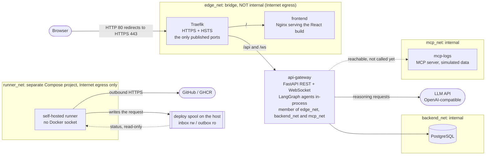
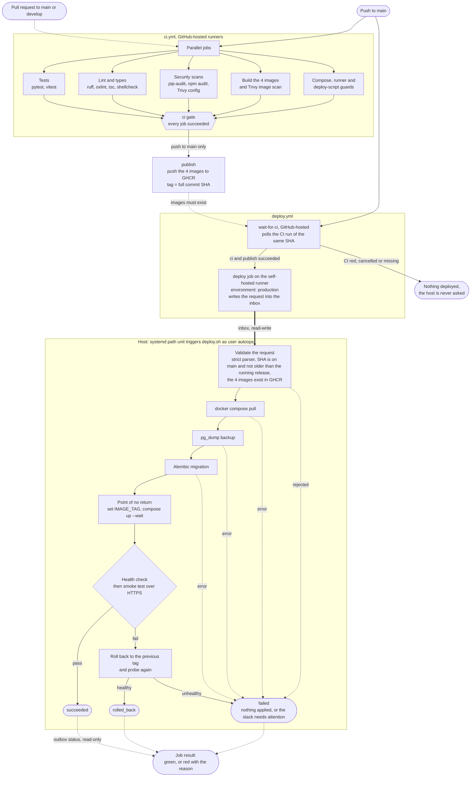

# AutoOps

Self-hosted, multi-agent SRE platform. AutoOps is a Tier-1 technical-support system: an operator opens an incident
ticket in a web dashboard, a [LangGraph](https://langchain-ai.github.io/langgraph/) pipeline of two AI agents
classifies its severity and proposes a root-cause analysis, and the reasoning is streamed to the browser while it
happens. The platform around it is the other half of the project: hardened containers on isolated networks, HTTPS behind
a single reverse proxy, a CI pipeline with security scans, and pull-based continuous delivery with automatic rollback
onto a hardened Ubuntu host.

> **Scope, honestly.** This README describes what exists in the repository today. The agents reason only over the text of
> the ticket, the logs MCP server serves simulated data and nothing calls it yet, and the Executor / human-approval
> agent is not built. See [Known limitations](#known-limitations) and the [Roadmap](#roadmap).

<!-- SCREENSHOT: dashboard overview (ticket table and agent console), full width. Add as docs/images/dashboard.png -->

## How a ticket flows

A ticket is created with a title and a description. Everything after that happens in the background, and the dashboard
follows it over REST (ticket table) and a WebSocket (agent console).

| Status | When | What happened |
|--------|------|---------------|
| **Open** | `POST /api/v1/tickets` returns `201` | The ticket is stored with a placeholder severity (`medium`; a `severity` sent by the client is ignored). The request does not wait for the agents; a background task starts. |
| **Investigating** | The task picks the ticket up | The graph runs: the **Triage agent** answers with one of `low`, `medium`, `high` or `critical` (an unrecognizable answer falls back to `medium`), then the **Investigator agent** receives the description plus that severity and writes root-cause hypotheses and what to check next. |
| **Escalated** | The graph finishes | The final severity and the Investigator's analysis are persisted (they survive a page reload) and the ticket is handed to a human. |

If the model call fails, the ticket returns to **Open**, its analysis is cleared and the console shows an error event.

While the graph runs, each step is broadcast as a JSON event (`ai_event`, with the node name and a message) to every
authenticated client connected to `/ws/stream`. The dashboard's agent console renders them live, and the ticket table
refreshes by polling (`VITE_TICKETS_POLL_INTERVAL_MS`, default 5 s).

```text
open ──► investigating ──► escalated
  ▲            │
  └── on failure (analysis cleared)
```

- The LangGraph graph is linear: `START → triage_node → investigator_node → END`
  ([`graph.py`](services/ai-engine/ai_engine/graph.py)). It runs **in-process inside the `api-gateway` container**; there
  is no separate AI-engine service.
- The Investigator has an injection point for technical context (logs, metrics) coming from MCP servers, but the gateway
  does not pass one today, so it works from the ticket text alone.
- The **logs MCP server** ([`services/mcp-servers/logs_server`](services/mcp-servers/README.md)) is deployed and reachable
  from the gateway over a private network. It exposes two read-only tools, `get_system_logs` and `get_db_metrics`, that
  return **simulated** data. Nothing calls them yet.
- `pending_approval` and `resolved` exist in the ticket model but no agent sets them.

<!-- SCREENSHOT: ticket creation form and a ticket moving Open -> Investigating -> Escalated. Add as docs/images/ticket-flow.png -->
<!-- SCREENSHOT: agent console streaming the Triage and Investigator reasoning. Add as docs/images/agent-console.png -->
<!-- SCREENSHOT: the analysis dialog of an escalated ticket. Add as docs/images/analysis.png -->

## Architecture

Everything runs from one Compose file ([`docker-compose.yml`](docker-compose.yml)). **Traefik is the only service that
publishes host ports**; the dashboard and the API share one origin behind it.



| Network | Internal | Members | Why |
|---------|----------|---------|-----|
| `edge_net` | no | `traefik`, `frontend`, `api-gateway` | The only network with Internet egress for the stack: the gateway needs the LLM API, and Traefik needs ACME when `TLS_MODE=acme`. Traefik has a fixed address here, and it is the only peer whose `X-Forwarded-*` headers the gateway trusts. |
| `backend_net` | **yes** | `postgres`, `api-gateway`, and the `migrate` job | PostgreSQL has no route to the Internet or to the host. |
| `mcp_net` | **yes** | `mcp-logs`, `api-gateway` | The MCP server is reachable only from the gateway. |
| `runner_net` | no | the self-hosted runner | Defined in [`infra/runner/docker-compose.yml`](infra/runner/docker-compose.yml), a Compose project of its own, so a runner failure never touches the stack. It shares no network with the application. |

- **Routing:** `Host(DOMAIN)` is the only host Traefik answers. `/api` and `/ws` go to the gateway (REST under
  `/api/v1`, WebSocket at `/ws/stream`); everything else goes to the frontend
  ([`routes.yml`](infra/traefik/dynamic/routes.yml)). Details in [`infra/traefik/README.md`](infra/traefik/README.md).
- **The runner never touches Docker.** It leaves a deploy request in a spool directory and the host, not GitHub, validates
  and applies it. See [`infra/runner/README.md`](infra/runner/README.md) and [`infra/deploy/README.md`](infra/deploy/README.md).
- **MCP isolation is a design rule** ([`.claude/CLAUDE.md`](.claude/CLAUDE.md)): the AI engine must not connect to PostgreSQL
  or run OS commands, only reach infrastructure through MCP servers. Today the gateway persists tickets itself and the agents
  only receive the ticket text, so the rule holds trivially; the MCP path is where it will matter once the Investigator uses it.
- `docker-compose.dev-db.yml` is an optional development override that publishes PostgreSQL on the host loopback only; it is
  not used in production.

## CI/CD pipeline

A merge to `main` is built, scanned, published and deployed without a manual step. GitHub never holds a way into the host:
the self-hosted runner only leaves a request, and the host pulls and applies the release itself.



- **CI** ([`ci.yml`](.github/workflows/ci.yml)) runs on pull requests and on pushes to `main` and `develop`. Only a push to
  `main` reaches `publish`, the only job with a write token. The aggregate `ci` job is the single status that branch
  protection requires. Job-by-job detail is in [`infra/ci/README.md`](infra/ci/README.md).
- **Images** are tagged with the full commit SHA only; there is no `latest`. A rollback is another SHA.
- **`deploy.yml`** starts on the same push and its first job waits for the `ci` and `publish` jobs of that commit
  (polling every 20 s, up to 30 min). Deploys are serialized and a deploy in flight is never cancelled.
- **The host** validates the request as untrusted input, takes a database backup before migrating, and only rewrites
  `IMAGE_TAG` after pull, backup and migration succeeded. The health probe and an HTTPS smoke test
  ([`smoke_test.sh`](scripts/ops/smoke_test.sh)) gate the release; a failure rolls back to the previous tag. A rollback
  restores **images only**: migrations are not reverted, so schema changes must be backward compatible.
- **Outcomes:** `succeeded`, `rolled_back`, `failed`, or no answer in time. Exit codes, status format, the threat model and
  the drill log are in [`infra/deploy/README.md`](infra/deploy/README.md).

## Tech stack

| Layer | Technology |
|-------|------------|
| Backend | Python 3.11, FastAPI (REST and WebSocket), Pydantic, SQLAlchemy (async, asyncpg), Alembic, argon2-cffi, PyJWT |
| Agents | LangGraph, LangChain (`ChatOpenAI`, any OpenAI-compatible endpoint), MCP Python SDK (FastMCP over HTTP + SSE) |
| Data | PostgreSQL 15 |
| Frontend | React, Vite, TypeScript (strict), TailwindCSS, Zustand; Vitest and oxlint |
| Edge | Traefik v3 (file provider, no Docker socket), self-signed local CA or Let's Encrypt (HTTP-01) |
| Containers | Docker Engine and Compose; multi-stage images published to GHCR |
| CI/CD | GitHub Actions, a containerized self-hosted runner, systemd units on the host |
| Host | Ubuntu Server 26.04, idempotent Bash provisioning (no configuration-management tool), UFW, fail2ban, OpenSSH |
| Tests | pytest, Vitest, and Bash test scripts with fake `docker`/`curl` for the deploy tooling |

## Security decisions

Each item says where it is implemented, so it can be checked rather than trusted.

**Containers**
- Every application container drops all capabilities and sets `no-new-privileges`. The gateway, frontend, MCP server,
  Traefik and the migration job also run with a read-only root filesystem (writable `tmpfs` only where needed). PostgreSQL
  keeps just the five capabilities it needs to start and drop to its own user. See `x-hardening` in
  [`docker-compose.yml`](docker-compose.yml).
- Images run as non-root users (gateway and MCP server `10001`, Traefik `65532`, unprivileged Nginx on port 8080) and are
  multi-stage. Build tools (`pip`, `setuptools`, `wheel`) are removed from the Python runtime stages.
- The Docker socket is not mounted into any container. Traefik reads its routes from files baked into its image.
- Docker daemon defaults are hardened and log-rotated ([`infra/docker/`](infra/docker/README.md)).

**Network**
- `backend_net` (PostgreSQL) and `mcp_net` (MCP server) are `internal`: no Internet and no host access. Only Traefik
  publishes host ports; see the [network table](#architecture).
- The host firewall is deny-by-default and also covers Docker-published ports through the `DOCKER-USER` chain, because
  UFW alone does not filter them ([`infra/firewall/`](infra/firewall/README.md)).

**Transport**
- HTTP is permanently redirected to HTTPS. `Strict-Transport-Security` is set (`HSTS_MAX_AGE_SECONDS`, one year by default,
  without `includeSubDomains` or `preload`). Traefik answers only for `Host(DOMAIN)`.
- `TLS_MODE=selfsigned` (a local CA, see [`infra/traefik/README.md`](infra/traefik/README.md)) or `TLS_MODE=acme`
  (Let's Encrypt). The mode has no default on purpose, and CI checks that the Compose file rejects a missing value.
- [`scripts/ops/validate_env.sh`](scripts/ops/validate_env.sh) refuses to start a production stack with placeholder
  secrets, a weak `JWT_SECRET`, incomplete TLS settings or an unpinned image tag.

**Authentication and abuse control**
- Passwords are stored as argon2id hashes. Login returns a short-lived JWT (HS256, `JWT_TTL_MINUTES`, default 60 minutes).
  Every REST route except the health checks requires it. `JWT_SECRET` has no default and must be at least 32 characters.
- The WebSocket takes its token as the **first message**, not in the URL, because the proxy logs URLs. An invalid or
  expired token closes the socket with code `4401`.
- A wrong username and a wrong password return the same `401`. Failed logins are rate limited per client IP (`429` with
  `Retry-After`). Behind Traefik the real IP comes from `X-Forwarded-For`, trusted only from Traefik's fixed address.
  The limiter is in memory ([limitation](#known-limitations)). Details: [Authentication](#authentication).

**Supply chain and CI** ([`infra/ci/README.md`](infra/ci/README.md#security-scans))
- Scans that block the merge: **ruff** (including the bandit `S` rules), **pip-audit** on the three requirements files,
  **npm audit** from `high` upwards on production dependencies, **Trivy** on the four built images (HIGH/CRITICAL with a
  fix available) and **Trivy config** on every Dockerfile. The Trivy binary is pinned. An ignore entry must carry a written
  justification, a review rule stated in [`.trivyignore`](.trivyignore).
- Every third-party GitHub Action is pinned to a full commit SHA. Workflows default to read-only permissions; only `publish`
  has `packages: write`. There is no `pull_request_target`, and no job persists the checkout credentials.
- Shell scripts are linted with shellcheck, and the Compose and workflow rules that protect the runner are enforced by
  guards that have their own tests proving they fail when weakened.

**Deployment path** ([`infra/runner/README.md`](infra/runner/README.md), [`infra/deploy/README.md`](infra/deploy/README.md))
- The runner executes workflow code, so it is treated as untrusted: no inbound ports, no Docker socket or client, no
  capabilities, a read-only root and a `tmpfs` workspace. Its only door to the host is a spool with a read-write inbox
  and a read-only outbox, so it cannot forge a result.
- A workflow that uses the runner may only be triggered by `workflow_dispatch` or a push to `main` and must declare the
  `production` environment (enforced by [`check_runner_workflows.sh`](scripts/ci/check_runner_workflows.sh)).
- The host re-derives everything from public data: the request is parsed strictly (256 bytes, two keys, hex SHA), the SHA
  must be on `main` and not older than the running release, and the images must exist in the registry before anything is
  pulled.

**Host** ([`infra/README.md`](infra/README.md))
- SSH: public keys only, no root login, an explicit `AllowUsers`, `MaxAuthTries 3`, modern key exchange and ciphers, no
  forwarding. Applying it arms an automatic rollback so a mistake cannot lock the operator out
  ([`infra/ssh/`](infra/ssh/README.md)).
- UFW deny-by-default; the only public ports are the proxy's. fail2ban bans repeated SSH failures with progressive ban
  times ([`infra/fail2ban/`](infra/fail2ban/README.md)). A kernel `sysctl` baseline and unattended OS updates.
- `scripts/provision/verify.sh` re-checks every control and exits non-zero on drift; every provisioning step has a matching
  check.

**Data**
- `pg_dump` backups on a systemd timer with retention, plus a dump before every deploy migration. Restore is destructive,
  asks for confirmation and runs in a single transaction ([`infra/backup/`](infra/backup/README.md)).

Secrets live only in the git-ignored `.env`. The repository contains placeholders in [`.env.example`](.env.example), and CI
runs without any secret of its own.

## Monorepo structure

```
autoops/
├── apps/
│   ├── frontend/        # Admin dashboard (React + Vite + TypeScript + TailwindCSS)
│   └── api_gateway/     # FastAPI: REST, WebSockets and authentication
├── services/
│   ├── ai-engine/       # LangGraph agents (Triage, Investigator, Executor)
│   └── mcp-servers/     # MCP servers (DB, logs and metrics isolation)
├── scripts/
│   ├── provision/       # Idempotent host bootstrap (bootstrap.sh), verify.sh and per-control checks
│   ├── ops/             # Operational scripts (PostgreSQL backup and restore, env validation)
│   └── ci/              # Guards run by CI (self-hosted runner lock-down and allowed workflows)
├── infra/               # Host configuration templates and docs (SSH, UFW, Docker, systemd, backups, CI, self-hosted runner)
├── .claude/
│   ├── CLAUDE.md        # Project architecture and standards
│   └── context/         # SDD documentation (plan, user stories, summaries)
├── .env.example         # Centralized environment variable template
├── .gitignore
└── README.md
```

## Prerequisites

**AutoOps runs on Linux only**, with Docker Compose (tested on Ubuntu Server, on bare metal or in a VM).

- Docker Engine with the Compose plugin
- `git`, `openssl`, `curl` and `sudo` (the TLS script needs root)
- An LLM API key (`OPENAI_API_KEY`; the AI engine uses `ChatOpenAI`, optionally against another OpenAI-compatible
  endpoint through `OPENAI_BASE_URL`)
- To run the tests from the host: Python 3.11+ and Node.js 22 (see `apps/frontend/.nvmrc`)

> **Windows and macOS are not supported.** The provisioning and operations scripts are Bash, and the TLS script
> needs root on Linux.

## Quickstart (Docker Compose behind Traefik, HTTPS)

```bash
# 1. Get the code and the configuration
git clone https://github.com/Sanchochx/autoOps.git autoops && cd autoops
cp .env.example .env
```

```bash
# 2. Edit .env. At least: DB_PASSWORD, JWT_SECRET (openssl rand -hex 32), OPENAI_API_KEY, AI_MODEL_NAME (e.g. gpt-4o-mini),
#    DOMAIN (default autoops.local), TLS_MODE=selfsigned, PUBLIC_SCHEME=https
#    DATABASE_URL in .env.example is only for host-side tools; Compose builds its own from DB_*.
```

```bash
# 3. Local certificate authority + server certificate (TLS_MODE=selfsigned). Writes ./tls
sudo APP_DIR="$PWD" TLS_DIR="$PWD/tls" ./scripts/provision/65_tls.sh
```

```bash
# 4. Start the stack and apply the database migrations (`up` does NOT migrate)
docker compose up -d --build --wait
docker compose --profile tools run --rm migrate
```

```bash
# 4b. Create the first dashboard user. Username and password are typed at a prompt (no echo);
#     they are never read from .env, the environment or the command line.
scripts/ops/create_user.sh
```

```bash
# 5. Make the domain resolve and trust the local CA (on the machine that runs the browser)
echo "127.0.0.1 autoops.local" | sudo tee -a /etc/hosts        # use the VM's IP if the browser is elsewhere
sudo cp tls/ca/ca.crt /usr/local/share/ca-certificates/autoops-local-ca.crt && sudo update-ca-certificates
# Firefox keeps its own store; see infra/traefik/README.md ("Trusting the local CA").
```

Open `https://autoops.local`, sign in with the user from step 4b, create a ticket and watch the agents in the console. It goes **Open → Investigating →
Escalated**, with the Investigator's analysis in the table (persisted in the database, so it survives a reload).
If the AI call fails, the ticket returns to **Open** and the console shows the error; check
`docker compose logs api-gateway`.

### Verify it works

```bash
source venv/bin/activate && pip install -r apps/api_gateway/requirements-dev.txt -r services/ai-engine/requirements.txt
pytest tests -v                                                      # backend tests (no network, no DB)
(cd apps/frontend && npm ci && npm test && npm run lint && npm run build)

# Post-deploy checks through HTTPS (run from the repository root, one line each)
SMOKE_DOMAIN=autoops.local SMOKE_HTTPS_PORT=443 SMOKE_HEALTH_PATH=/api/v1/health SMOKE_PROTECTED_PATH=/api/v1/tickets SMOKE_CACERT=tls/ca/ca.crt scripts/ops/smoke_test.sh
E2E_CONNECT_ADDR=127.0.0.1 python scripts/ops/e2e_https.py --ca tls/ca/ca.crt   # asks for a dashboard user's credentials
```

### Current limitations

- The MCP logs server (`services/mcp-servers/logs_server`) serves **simulated** data, and the Investigator does **not**
  query it yet: its analysis is based only on the text of the ticket. Paste real logs and stack traces into the description.
- There is no Executor agent or approval flow (HITL) yet: a successfully investigated ticket is `escalated` to a human;
  `pending_approval` and `resolved` are not used by the agents.
- Authentication is a single role: every signed-in user can do everything (including `DELETE /api/v1/tickets`).
  Tokens last `JWT_TTL_MINUTES` (default 60) and there is no refresh token: the dashboard asks to sign in again when
  one expires. The token is kept in memory only, so reloading the page also asks for it.
- The failed-login limiter is in memory (per client IP, `LOGIN_MAX_ATTEMPTS` per `LOGIN_WINDOW_SECONDS`): enough for the
  single gateway container; several replicas would need a shared store.

### Authentication

- `POST /api/v1/auth/login` (`{"username", "password"}`) returns a short-lived Bearer token. Every other REST endpoint
  requires `Authorization: Bearer <token>`, except the public health checks (`/api/v1/health`, and `/health` inside the
  container). Passwords are stored as argon2id hashes in the `users` table.
- WebSocket (`/ws/stream`): connect, then send `{"type": "auth", "token": "<token>"}` as the **first message** within
  `WS_AUTH_TIMEOUT_SECONDS` (5 s). The token is not accepted in the URL because the proxy logs URLs. A missing, invalid
  or expired token closes the socket with code `4401`; the socket is also closed when its token expires.
- A wrong username and a wrong password get the same `401`. Failed logins are limited per client IP (`429` with
  `Retry-After`); behind Traefik the real IP comes from `X-Forwarded-For`, trusted only from Traefik's fixed address
  (`EDGE_TRAEFIK_IP`, uvicorn `--proxy-headers --forwarded-allow-ips`).
- Secrets: `JWT_SECRET` (at least 32 characters, no default; the gateway refuses to start without it and
  `validate_env.sh` enforces it in production). There are no user credentials in `.env`.
- Users: `scripts/ops/create_user.sh` (interactive; also resets the password of an existing user).

### Run published images (no local build)

CI publishes the images to GHCR from `main`, tagged with the commit SHA. To run a given commit:

```bash
export IMAGE_REPOSITORY=ghcr.io/<owner>/autoops IMAGE_TAG=<full commit SHA>   # also settable in .env
docker compose pull && docker compose up -d --no-build
```

Without those variables `docker compose up -d --build` builds locally and tags `autoops/<service>:dev`. See
[`infra/ci/README.md`](infra/ci/README.md#images-us-cicd-002).

### Database migrations (Alembic, from the monorepo root)

```bash
alembic -c apps/api_gateway/alembic.ini upgrade head     # apply migrations
# Under Docker Compose `up` does NOT migrate; run: docker compose --profile tools run --rm migrate
alembic -c apps/api_gateway/alembic.ini current          # current revision
alembic -c apps/api_gateway/alembic.ini revision --autogenerate -m "description"
```

Requires `DATABASE_URL` (`postgresql+asyncpg://...`) in `.env`.

### Host provisioning (Ubuntu Server 26.04)

```bash
sudo ./scripts/provision/bootstrap.sh --env-file provision.env   # idempotent
sudo ./scripts/provision/verify.sh --env-file provision.env      # OK/FAIL table, exit 1 on any failure
```

See [`infra/README.md`](infra/README.md) for the full cycle (variables, SSH confirmation, reboot test).

### Self-hosted runner (optional, for continuous deployment)

With `RUNNER_REPO_URL` set in `.env`, `bootstrap.sh` also installs a containerized GitHub Actions runner
(`autoops-runner.service`, label `autoops-prod`): outbound connections only, no Docker socket, no access to the stack's
networks, and usable only by `workflow_dispatch` / push-to-`main` workflows. See
[`infra/runner/README.md`](infra/runner/README.md). The runner never touches Docker: it leaves a deploy request that the host
validates and applies itself, with automatic rollback, see [`infra/deploy/README.md`](infra/deploy/README.md).

### Continuous delivery

A push to `main` with a green CI is deployed automatically (`.github/workflows/deploy.yml`): the workflow waits for the CI and
the published images, asks the host through the runner, and the host applies the release, runs a smoke test over HTTPS and rolls
back if it fails. See [`infra/deploy/README.md`](infra/deploy/README.md#continuous-delivery-us-cicd-005).

The definitive commands are documented in [`.claude/CLAUDE.md`](.claude/CLAUDE.md#key-commands).

## Key principles

- **Twelve-Factor (zero hardcoding):** credentials, keys, URLs and ports are always read from environment variables (`.env`).
- **MCP isolation:** the AI engine never connects directly to PostgreSQL nor runs system commands; all infrastructure interaction goes through authorized MCP servers.
- **Cloud-native logging:** all services emit logs to stdout/stderr; no local files are written or rotated.

## Workflow (SDD)

The project follows Spec-Driven Development: one user story at a time, acceptance criteria one by one, and a mandatory checkpoint before moving on.

- [Implementation plan](.claude/context/IMPLEMENTATION_PLAN.md)
- [Task execution workflow](.claude/context/TASK_EXECUTION.md)
- [Architecture and standards guide](.claude/CLAUDE.md)

### Branches

| Branch | Purpose |
|------|-----------|
| `main` | Production / deployment-ready code |
| `develop` | Feature integration |
| `feature/descriptive-name` | New features |
| `fix/bug-name` | Bug fixes |

```text
+============================================================================+
   _____                  __               ____           
  / ___/____ _____  _____/ /_  ____       / __ \___ _   __
  \__ \/ __ `/ __ \/ ___/ __ \/ __ \     / / / / _ \ | / /
 ___/ / /_/ / / / / /__/ / / / /_/ /    / /_/ /  __/ |/ / 
/____/\__,_/_/ /_/\___/_/ /_/\____/____/_____/\___/|___/  
                                 /_____/                  

               .-"""-.
             _/-=-.   \
            (_|a a/   |_
             / "  \   ,_)
        _    \`=' /__/
       / \_  .;--'  `-.
       \___)//      ,  \
        \ \/;        \  \
         \_.|         | |
          .-\ '     _/_/
        .'  _;.    (_  \
       /  .'   `\   \\_/
      |_ /       |  |\\
     /  _)       /  / ||
    /  /       _/  /  //
    \_/       ( `-/  ||
              /  /   \\ .-.
              \_/     \'-'/
                       `"`
+============================================================================+

> _
